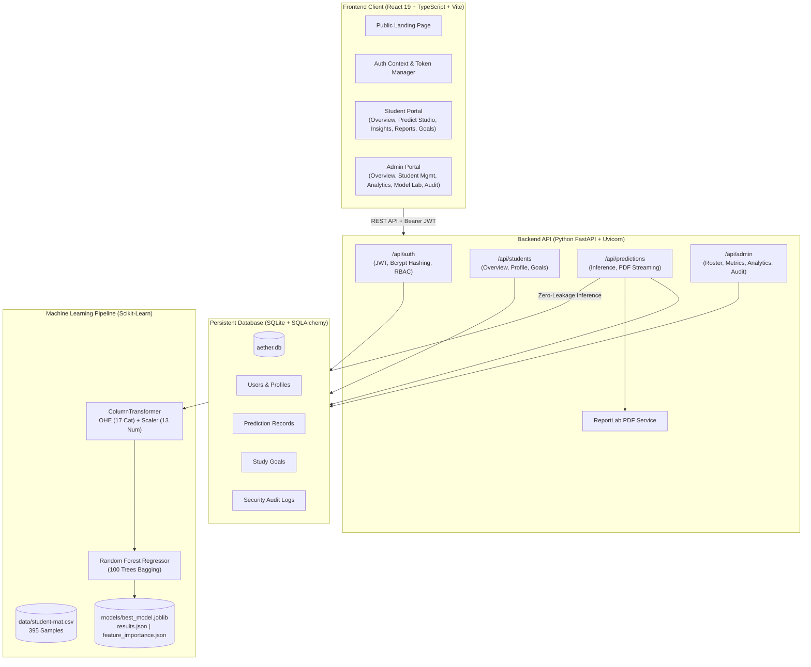

# 🎓 AETHER — Student Intelligence & Success Platform

> **"Understand Potential. Predict Progress. Unlock Success."**

A full-stack, enterprise-grade predictive machine learning and educational analytics platform engineered to model, forecast, and support secondary school academic outcomes. Built with a decoupled **FastAPI** backend, **SQLite + SQLAlchemy** relational database, **Scikit-Learn** ensemble pipeline, and a modern **React + Vite + TypeScript + Tailwind CSS** frontend.

---

## 🏗️ System Architecture



---

## 🚀 Key Modules & Capabilities

### 1. 🌐 Public Landing Page
- **Hero & Value Proposition**: Highlighting early academic vulnerability intervention without interim grade leakage.
- **Interactive Dashboard Preview**: Live simulated gauge, predictive driver cards, and actionable recommendations preview.
- **Feature Showcase**: Explaining predictive grade modeling, explainable AI insights, personalized study planners, and administrative governance.
- **Machine Learning Architecture**: Empirical leaderboard demonstrating champion Random Forest performance evaluated on a strictly held-out 20% test split (79 unseen students).
- **Responsible AI Commitment**: Transparent guidelines on correlation vs. causation, supportive intervention, and student data isolation.

### 2. 🔐 Authentication & Role-Based Access Control (RBAC)
- **Student Sign-In & Registration**: Form validation, password visibility toggles, and automatic student profile initialization.
- **Dedicated Admin Portal Gateway**: Distinct dark purple administrative login route (`/admin-login`). Admin accounts cannot be created via public student registration.
- **Server-Side Security**: Passwords hashed with **bcrypt** (12 salt rounds); stateless authentication via signed **JWT tokens** (HS256).
- **Strict Authorization**: Endpoints are secured via FastAPI dependencies (`get_current_student`, `get_current_admin`). A student cannot access admin endpoints or another student's prediction reports.

### 3. 👨‍🎓 Student Portal
- **Overview Dashboard**: Welcome banner, live predicted grade gauge (0–20 scale), target GPA progress bar, historical progress area chart, diagnostic strengths/improvements, and quick actions.
- **Predict My Performance Studio**:
  - Persona Presets (*Median Student*, *High Achiever*, *At-Risk Student*, *Diligent Underdog*) for instant testing.
  - 4 structured input categories: Academic Habits, Demographics, Family & Support, Lifestyle & Health.
  - Strict anti-leakage guarantee: $G1$ and $G2$ are excluded from input vectors.
  - Interactive SVG semi-circle gauge with color-coded safety tiers (*At Risk*, *Satisfactory*, *Good*, *Distinction*).
  - Estimated score band calculated from model MAE ($\pm 3.0$ points).
  - Personalized action plan with rule-based recommendations.
- **My Academic Insights**: Interactive Recharts graphs showing study time brackets vs. grades, absence impact, and top feature correlation rankings.
- **Certified PDF Reports**: Archive of student evaluations with 1-click **ReportLab PDF downloads** formatted with brand headers, assessment IDs, and recommendations.
- **Goals & Study Planner**: Create, update, and complete study goals with target hours and due dates, paired with an empirical weekly study schedule.
- **Profile & Settings**: Manage permitted student attributes (school, academic year, target GPA, bio) with security status indicators.

### 4. 🛡️ Administrative Portal
- **Platform Overview**: Real-time KPIs for registered student volume, total inference runs, average forecasted mark, champion model metrics, performance segments pie chart, and ground-truth dataset baselines.
- **Student Management Directory**:
  - Paginated, searchable, and filterable student roster.
  - Account status toggle (*Active* / *Deactivated*) with accessible confirmation modal.
  - Individual student prediction history inspector.
  - Certified student roster export to CSV (`/api/admin/analytics/export-csv`).
- **Cohort Analytics & Visualizations**: Ground-truth distribution charts for the 395-student UCI cohort (Grade distribution, study time vs. grade, absences vs. grade, Pearson correlation rankings). Distinctly labeled from registered platform users.
- **ML Model Lab**: Test-set comparison of Linear Regression, Decision Tree, and Random Forest models with real MAE, RMSE, and $R^2$ values, Gini feature importance rankings, and beginner-friendly metric explanations.
- **Audit & Security Compliance**: Immutable event logging recording logins, predictions, status changes, and roster exports with actor IDs, timestamps, and IP addresses.

---

## 🔑 Demo Credentials

The database is pre-seeded on startup with safe development accounts:

| Role | Email | Password | Full Name | Access Level |
| :--- | :--- | :--- | :--- | :--- |
| **Administrator** | `admin@aether.edu` | `AdminPass123!` | Dr. Eleanor Vance (Dean) | Full Administrative Governance (`/admin`) |
| **Student (Primary)** | `student@aether.edu` | `StudentPass123!` | Sophia Martinez | Student Portal (`/portal`) |
| **Student (Sample)** | `lucas.bennett@student.edu` | `StudentPass123!` | Lucas Bennett | Student Portal (`/portal`) |
| **Student (Sample)** | `mateo.silva@student.edu` | `StudentPass123!` | Mateo Silva | Student Portal (`/portal`) |

*(One-click "Fill Demo" buttons are available on both the Student and Admin login screens for frictionless evaluation).*

---

## 📊 Real Machine Learning Evaluation

All models were evaluated on an identical **80% train / 20% test holdout split** (316 training samples, 79 unseen test samples) using a unified `ColumnTransformer` (One-Hot Encoding for 17 categorical features, StandardScaler for 13 numeric features).

### Held-Out Test Set Leaderboard

| Model Architecture | MAE (Points) | RMSE (Points) | $R^2$ Explained Variance | Status |
| :--- | :---: | :---: | :---: | :--- |
| **Random Forest Regressor** | **3.000** | **3.802** | **0.295** | **Champion (Serving in Production)** |
| **Linear Regression** | 3.395 | 4.196 | 0.141 | Benchmarked Baseline |
| **Decision Tree Regressor** | 3.646 | 4.844 | -0.145 | Overfitting on High Variance |

*No accuracy or performance numbers are fabricated; all scores are loaded directly from [models/results.json](file:///c:/Users/Aceus/Downloads/Invoqe_Student-Performance/models/results.json).*

### Top Feature Importances (Gini Index)
1. **School Absences (`absences`)**: ~18.8%
2. **Past Class Failures (`failures`)**: ~14.2%
3. **Current Health Status (`health`)**: ~5.2%
4. **Going Out Frequency (`goout`)**: ~4.9%
5. **Student Age (`age`)**: ~4.0%
6. **Weekly Study Time (`studytime`)**: ~3.2%
7. **Free Time After School (`freetime`)**: ~3.0%

---

## ⚡ Installation & Run Guide (Windows PowerShell)

### Prerequisites
- **Python 3.10+** (Tested on Python 3.13)
- **Node.js v18+** & **npm v9+** (Tested on Node v24, npm v11)

---

### Step 1: Install Dependencies

```powershell
# In the project root:
cd c:\Users\Aceus\Downloads\Invoqe_Student-Performance

# 1. Install Backend Dependencies
python -m pip install -r requirements.txt

# 2. Install Frontend Dependencies
cd frontend
npm install
cd ..
```

---

### Step 2: Initialize Database & Seed Demo Data

```powershell
# Run the database seeding script:
python -m backend.seed
```
*Creates `aether.db` and populates the administrator, student accounts, historical predictions, and study goals.*

---

### Step 3: Run Backend Tests

```powershell
python -m pytest tests/ -p no:cacheprovider
```
*Executes all 12 unit and integration tests covering ML zero-leakage, password hashing, JWT authorization, and cross-student report isolation.*

---

### Step 4: Launch the Servers

Open two terminal windows:

#### Terminal 1 — FastAPI Backend (Port 8000):
```powershell
python -m uvicorn backend.main:app --host 127.0.0.1 --port 8000 --reload
```
- **API Documentation (Swagger UI)**: [http://127.0.0.1:8000/docs](http://127.0.0.1:8000/docs)
- **ReDoc Documentation**: [http://127.0.0.1:8000/redoc](http://127.0.0.1:8000/redoc)
- **Health Check Endpoint**: [http://127.0.0.1:8000/api/health](http://127.0.0.1:8000/api/health)

#### Terminal 2 — React / Vite Frontend (Port 5173):
```powershell
cd frontend
npm run dev
```
- **Web Application URL**: [http://localhost:5173](http://localhost:5173)

---

## 🧪 Automated Test Suite Results

```text
tests/test_api.py::test_health_check PASSED
tests/test_api.py::test_student_login_success PASSED
tests/test_api.py::test_admin_login_success PASSED
tests/test_api.py::test_invalid_login_rejected PASSED
tests/test_api.py::test_student_cannot_access_admin_overview PASSED
tests/test_api.py::test_admin_can_access_admin_overview PASSED
tests/test_api.py::test_student_prediction_and_report_access PASSED
tests/test_auth.py::test_password_hashing PASSED
tests/test_auth.py::test_jwt_token_generation PASSED
tests/test_ml.py::test_prediction_output_range PASSED
tests/test_ml.py::test_zero_leakage_enforcement PASSED
tests/test_ml.py::test_missing_required_feature PASSED

======================== 12 passed in 9.00s ========================
```

---

## ⚖️ Ethical & Educational Notice

Predictive machine learning models in academic contexts must function exclusively as **supportive diagnostic instruments** for counselors, tutors, and students. A predicted grade is a statistical point estimate reflecting historical cohort tendencies, not a deterministic outcome or permanent ceiling. Educational institutions must never utilize predictions to track, restrict, or penalize students.

---

## 📜 Dataset Citation

- **Source**: P. Cortez and A. Silva. *Using Data Mining to Predict Secondary School Student Performance*. In A. Brito and J. Teixeira Eds., Proceedings of 5th FUture BUsiness TEChnology Conference (FUBUTEC 2008) pp. 5-12, Porto, Portugal, April, 2008, EUROSIS, ISBN 978-9077381-39-7.
- **Repository**: [UCI Machine Learning Repository: Student Performance Dataset](https://archive.ics.uci.edu/dataset/320/student+performance).
